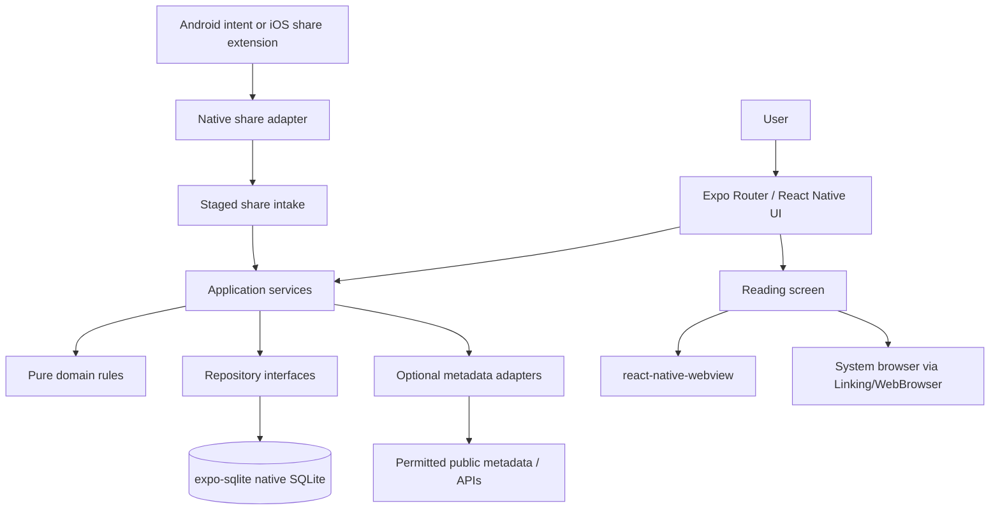

# System design

**Status:** Native migration design prepared; implementation pending.

**Product authority:** [PRD.md](PRD.md). **Delivery and verification:** [MILESTONES.md](MILESTONES.md). **Toolchain:** [TECH_STACK.md](TECH_STACK.md).

This document defines native boundaries and data flow. Requirement identifiers refer to the PRD; this is not a second requirements checklist.

## Architecture



The app shell, forms, lists, dialogs, timer, and status messages are React Native screens and components. Domain rules never import React Native, Expo, SQLite, WebView, filesystem APIs, or provider SDKs. Application services coordinate use cases but do not render UI. Repositories own all SQL and transaction boundaries. Platform adapters own native intents, file/document access, UUID generation, external-browser opening, app lifecycle signals, and timer wake/recovery hooks.

## Planned source layout

```text
src/
  app/                         # Expo Router routes and +native-intent.ts
  components/                  # NativeWind-styled semantic controls
  features/
    capture/                   # Paste/share staging and destination-aware form
    dashboard/                 # Capacity view and one next recommendation
    materials/                 # Inbox, Reading plan, Finished, editing/actions
    reading/                   # WebView reader, navigation, fallback, timer
    notes/                     # Plain-text independent notes
    settings/                  # Availability, import/export, app information
  domain.ts, types.ts           # Runtime-independent types and planning rules
  application/                 # Capture, lifecycle, timer, transfer use cases
  repositories/                # Interfaces plus SQLite implementations
  storage/
    sqlite/                    # Connection, schema, migrations, row mapping
    validation/                # Runtime record and backup validators
  platform/                    # Expo/native adapters with small interfaces
  providers/                   # Optional metadata adapters and result validation
  test/                        # Test factories and platform fakes
reference/web/                 # Historical snapshot; excluded from all native tooling
```

Keep feature code dependent on application interfaces rather than importing `expo-sqlite` or native modules directly. A route may subscribe to a repository-facing query hook, but SQL must not appear in a component.

## Reuse and rewrite boundary

The root `src/domain.ts`, `src/types.ts`, `src/domain.test.ts`, and `src/application/availability-reminder.ts` are runtime-independent candidates for direct reuse after review. Preserve their estimate precedence, zero/unknown semantics, capacity states, URL normalization, share-text extraction, recommendation ordering, and reminder behavior with native tests.

Adapt or rewrite the historical web application services around native interfaces. The capture service's save-first/enrich-later rule, duplicate retry, lifecycle transactions, note independence, session timestamps, and provider validation are reusable behavior. The Dexie repositories, browser subscriptions, service worker intake, Headless UI components, DOM links/dialogs, browser file download/upload code, and Vite/PWA setup are implementation-specific and must be rewritten. `data-transfer.ts` must be split so validation and serialization are reusable while storage reads/writes move to a native repository.

## SQLite persistence

Use one stable native database identity, for example `stop-tumpuk-reading-plan.sqlite`, and keep the schema version in the SQLite migration table. Do not reset or replace this database on launch or after an upgrade error. Every released schema change gets a forward migration, an upgrade test, and a recovery path.

| Table | Purpose and important fields |
| --- | --- |
| `materials` | Stable `id`, original and normalized HTTP(S) URLs, domain, title, nullable thumbnail, type, lifecycle status, source duration/provenance/completeness, playback speed, nullable manual estimate, timestamps. No priority or multiplier fields. |
| `notes` | Stable `id`, `material_id`, plain-text content, created/updated timestamps. `material_id` is non-unique so one material has multiple notes. |
| `settings` | Singleton row with nullable weekday/weekend minutes, onboarding dismissal, availability reminder timestamp, and current settings version. |
| `sessions` | Stable `id`, `material_id`, started timestamp, elapsed seconds, running/paused/ended state, state-change timestamp, nullable ended timestamp. |
| `material_events` | Stable event ID, material ID, lifecycle event type, UTC timestamp, and any minimal event metadata needed for history. |
| `capture_intake` | Stable staged-share ID, candidate URL/text/title metadata, received/consumed timestamps, and a consumed marker. It is disposable and excluded from exports. |
| `schema_migrations` | Migration bookkeeping owned by the SQLite adapter. Never use it to conceal a destructive reset. |

Store seconds internally and UTC timestamps as ISO strings or an explicitly documented SQLite representation. `null` means unknown and zero is a known value. Compute estimated time, capacity, and recommendations from current rows; do not maintain redundant authoritative totals.

Use parameterized `runAsync`/prepared statements for user or provider values. Map SQL rows to domain records at the repository boundary and validate both directions. Lifecycle mutations, associated events, completion, and delete cascades must be transactional. Delete removes related notes, sessions, events, and intake references in the same transaction.

## Native migration and backup policy

The old web IndexedDB database is not visible to a native app. The first native database is initialized as a new local store, but the app provides explicit import of the current web backup envelope. Import validates the complete JSON structure, IDs, references, URL schemes, statuses, durations, timestamps, and numeric bounds before opening a write transaction.

Keep the current web export marker and version as a supported input. Preserve material and note IDs, all notes and associations, estimates, settings, sessions, and lifecycle history. Exclude capture intake, browser-only metadata, credentials, and disposable UI state. Preview ID conflicts and import only non-conflicting records additively; never overwrite or clear local data. Reject unsupported, malformed, or future formats before any write. A failed import rolls back completely.

Keep pure `parseExport`, `validateEnvelope`, `serializeExport`, and conflict-calculation code independent of SQLite. A native transfer service supplies repositories to read/write validated records. The web implementation may remain in `reference/web/`, but native code must not import Dexie or its database instance.

After the first native release, database migrations preserve data. Test upgrades from every supported released schema, skipped releases, rollback/failure recovery, manual zero/unknown estimates, multiple notes, timer state, and existing event associations. If a downgrade is unsafe, provide a forward repair or export/recovery path; never switch to an empty database.

## Capture, metadata, and lifecycle flow

1. The form or share adapter parses candidate URLs with the shared pure URL validator. Multiple candidates require user selection.
2. The capture service creates a minimal material and, when Reading plan is selected, its capture and commitment events in one SQLite transaction.
3. The UI acknowledges only after durable commit. Duplicate detection warns and retries with the original destination.
4. Optional metadata adapters run after save with a bounded timeout and typed result validation. They re-read the current row before patching and cannot replace a manual title, estimate, or changed source URL.
5. Lifecycle commands (commit, in progress, finish, reopen, return to Inbox, archive, delete) update material and events transactionally. Finish never creates a note or timer state.

Provider fetches are optional network activity. Do not log raw notes, full shared text, or submitted URLs routinely. Treat provider output, thumbnails, and URL query strings as untrusted.

## Native share intake

Use `expo-sharing` configuration for Android `ACTION_SEND` URL/text payloads. This Expo SDK target has no iOS Share Extension or App Group target configured, so iOS native share-menu intake is explicitly unsupported; `app/+native-intent.ts` routes a stale or future iOS `expo-sharing` handoff to the capture screen with URL-paste guidance and does not read, stage, or consume a payload. Do not describe that fallback as iOS share support. An iOS extension/App Group can be added only as a separate native build and release decision.

On Android, Expo Router's `app/+native-intent.ts` redirects the incoming share intent to a handler route. The handler reads the payload through the sharing adapter, extracts URL candidates, writes a small `capture_intake` row, and navigates to the normal capture form. It never chooses Reading plan or Inbox for the user and never saves a material automatically.

Track a consumed intake ID so app relaunch or repeated route delivery cannot create duplicate saves. Keep the original text only until candidate extraction and do not include it in export or routine logs. If the native integration is unavailable or malformed, show a recoverable error and keep paste available.

The Expo documentation labels receiving shares experimental and notes that iOS opens the main target rather than a fully supported sharing view controller. Therefore Android intent-filter and physical-device validation is an early release gate. This target records the iOS decision as URL-paste fallback until a separate share-extension/App Group implementation and device test are authorized. A deep-link unit test cannot establish OS share-menu behavior.

## WebView reading boundary

The reading route owns the selected material and renders only the saved HTTP(S) URL in `react-native-webview`. Configure a narrow origin policy and navigation handler:

- allow the intended HTTP(S) source navigation and ordinary in-page navigation where the product permits it;
- show loading/progress and a recoverable error with Retry and Open in browser;
- intercept non-HTTP(S) schemes and route them to an explicit system action or block them with a clear message;
- use `Linking`/`expo-web-browser` for the external fallback and report failure;
- do not inject arbitrary JavaScript, expose a broad `postMessage` bridge, or pass SQLite records into the page;
- do not treat page load, navigation, scroll, playback, or timer expiry as completion;
- keep downloads, popups, login flows, media playback, and embedded providers subject to the feasibility matrix and fallback behavior.

Remote pages are untrusted and may be hostile, broken, authenticated, paywalled, or incompatible with a mobile WebView. The native UI remains usable when the page fails. WebView feasibility must be checked early against representative intended sources such as a public article, Medium/Substack-style article, YouTube video, and a login/paywall example before the rest of the reading UI is built.

## Timer and lifecycle handling

Persist timer state and timestamps; never rely on an interval to be authoritative. A timer controller observes AppState changes, recalculates elapsed time from persisted timestamps on foreground, pauses or ends explicitly, and cleans up subscriptions and intervals on unmount. Android process death and iOS suspension are recovery cases, not completion signals. A running timer's controls stay available while a panel is hidden or a WebView route changes.

## Runtime audits

- `crypto.randomUUID`: use a small UUID adapter backed by `expo-crypto` or a documented runtime-safe implementation; test uniqueness and failure handling.
- URL handling: use the standard URL parser only after checking native engine behavior; validate HTTP(S), preserve original URLs, and remove only known tracking parameters.
- `fetch` timeouts: use `AbortController` when supported and a bounded fallback; provider timeout must not fail capture.
- subscriptions: use Expo/React Native subscription removal handles and clean up on unmount and AppState transitions.
- file APIs: use `expo-document-picker`/`expo-file-system` for import/export; do not use DOM `File`, `Blob`, object URLs, or anchor downloads.
- external links: use `Linking.canOpenURL`/`openURL` or `expo-web-browser`; handle rejected schemes and user cancellation.
- timer lifecycle: persist timestamps, test background/foreground and process-recovery behavior on Android and iOS.

## Verification layers

Automated tests cover domain rules, runtime validation, transfer serialization, SQLite repositories/migrations, lifecycle transactions, provider fakes, and application services. Component tests cover destination selection, capacity states, one recommendation, notes, timer controls, WebView fallback state, and import preview where the test stack supports it.

Android emulator tests cover navigation, WebView loading/error/fallback, restart persistence, import/export, and configured intent handling. Android physical-device tests cover native share-menu URL/text delivery, process relaunch, persistence, offline local data, and representative websites. iOS simulator tests cover layout and navigation; iOS physical-device tests cover persistence, WebView behavior, AppState/timer recovery, share extension/App Group intake, signing, and release configuration. Store submission checks are separate from all automated and emulator results.

## Security and privacy

Render titles, notes, errors, and shared text as text. Keep remote WebView content isolated. Do not ship secrets in app configuration. Optional metadata providers and thumbnails disclose URLs to their hosts; explain enabled requests and keep them optional to the core workflow. Do not add a server-side URL fetcher without a separate authentication, abuse, SSRF, privacy, and cost design.

`reference/web/` remains outside compilation, runtime imports, tests, and formatting. Its service worker and IndexedDB are historical evidence only and are not part of the native architecture.
